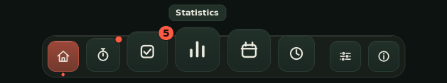
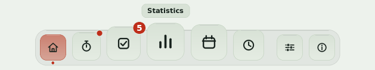
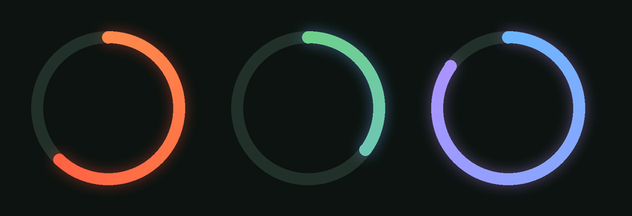
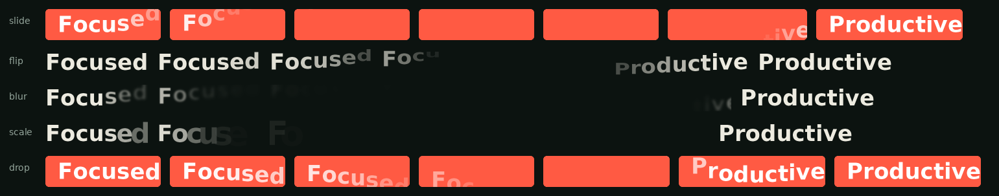
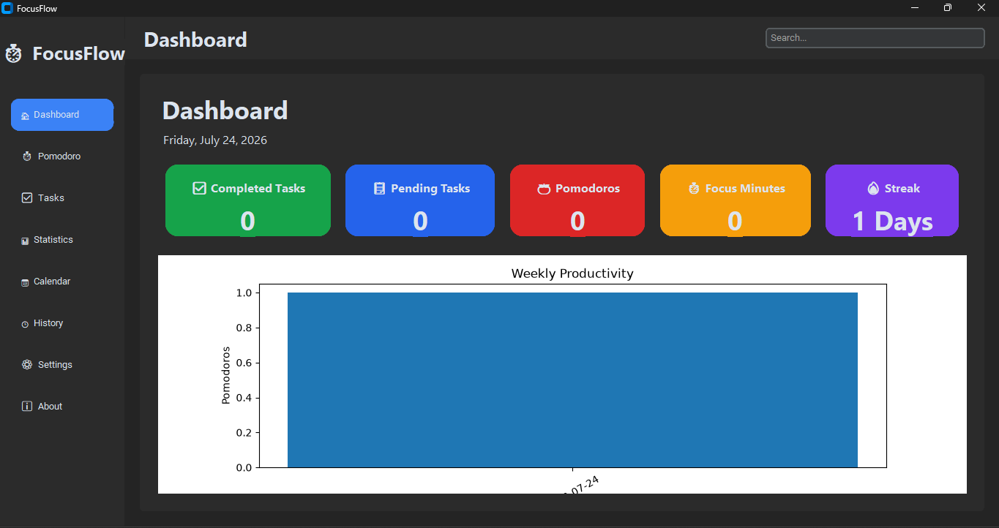
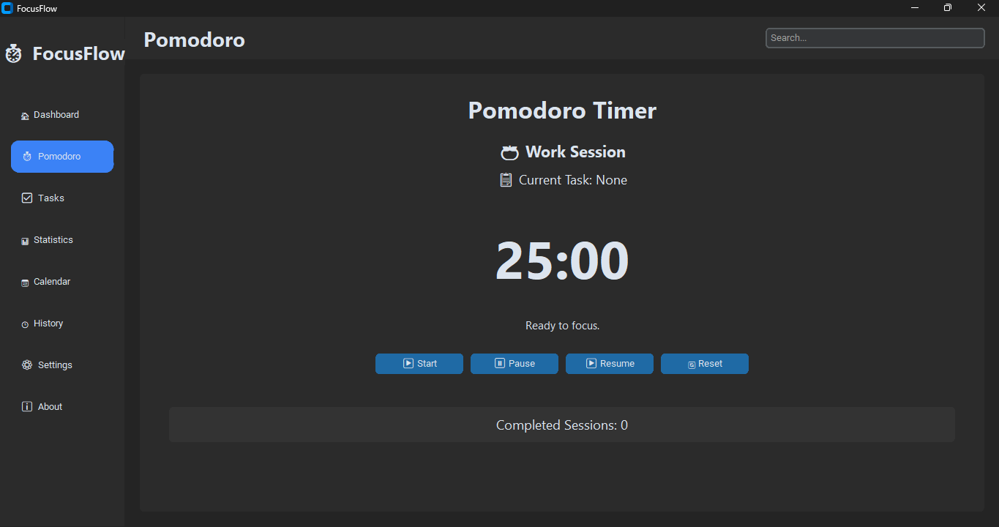
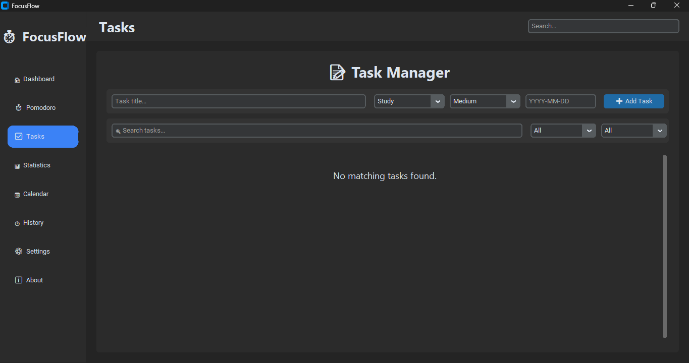
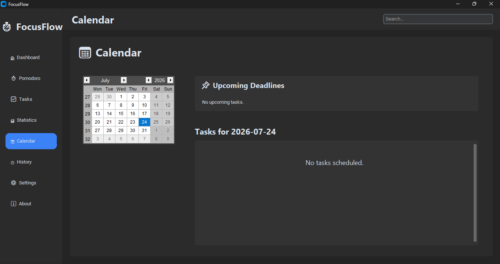
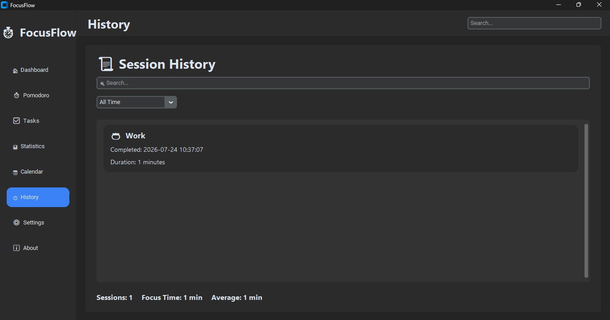

# 🍅 FocusFlow


A **Python Pomodoro productivity app** for students and professionals: focus timer, task manager, calendar, statistics and history in one fast, animated desktop application. Everything is stored locally in SQLite. There are no accounts and nothing leaves your machine.

---

# 🖥️ Preview

FocusFlow 2.0 is navigated with a **magnifying dock** and titles that animate letter by letter. These renders come straight from the app's own drawing code (`python tools/render_previews.py`):

<p align="center">
  <br>
  
</p>

<p align="center">
  <br>
  <sub>The timer ring: tomato = focus, leaf green = short break, sky blue = long break</sub>
</p>

<p align="center">
  <br>
  <sub>RotatingText frames – slide · flip · blur · scale · drop</sub>
</p>

<details>
<summary>Screenshots of the v1.0 interface (legacy)</summary>

<table>
  <tr>
    <td align="center"><br><b>Dashboard</b></td>
    <td align="center"><br><b>Pomodoro Timer</b></td>
  </tr>
  <tr>
    <td align="center"><br><b>Task Manager</b></td>
    <td align="center"><br><b>Statistics</b></td>
  </tr>
  <tr>
    <td align="center"><br><b>Calendar</b></td>
    <td align="center"><br><b>History</b></td>
  </tr>
</table>

These show the previous sidebar layout; v2.0 replaces it with the dock and a new visual design.
</details>

---

# ✨ What's new in 2.0

* **Dock navigation** with spring-physics magnification, hop-on-click, badges (open tasks, running timer), tooltips and right-click menus.
* **Animated text**: page titles and the dashboard headline use a letter-by-letter *RotatingText* (slide, flip, blur, scale and drop effects).
* **Cursor animation** (Windows): a comet trail, a magnetic ring that grows over clickable things, and click ripples.
* **A new timer**: a glowing progress ring in the colour of the current phase, confetti when you finish, the countdown in the window title, and keyboard shortcuts.
* **Native animated charts**: bars, donut and a 12-week activity heatmap. They replace Matplotlib and follow the theme.
* **Ctrl + K command palette**: jump to any page, run an action or find a task.
* **A real light theme**, a "System" option, and settings that persist.
* **Better task handling**: validated due dates with quick-pick chips, reopen finished tasks, status/category/priority filters.
* **A rewritten, tested core**: see the [CHANGELOG](CHANGELOG.md) for the bugs fixed (including a timer that ran at double speed after pausing).

---

# 📌 Features

✅ Pomodoro timer with focus, short-break and long-break cycles, auto-start and a daily goal

✅ Task manager with categories, priorities, due dates and per-task session counts

✅ Dashboard with today's goal, weekly chart, up-next list and achievements with progress

✅ Statistics for Today / Week / Month / All, a category breakdown, an activity heatmap and local insights

✅ Calendar planner with priority dots and one-click "add task for this day"

✅ Session history grouped by day, searchable and filterable

✅ Achievement and streak tracking

✅ Dark, Light or System theme; animations can be switched off

✅ Desktop notifications and sounds (both optional)

✅ CSV export of sessions and tasks

✅ SQLite storage, with automatic upgrade of v1.x databases

> **About "insights":** the suggestions on the Statistics page are simple, transparent rules over your own history. They run locally. No AI service is involved.

---

# ⌨️ Keyboard shortcuts

| Keys | Action |
|------|--------|
| `Ctrl + K` | Command palette |
| `Ctrl + 1` … `Ctrl + 8` | Switch page |
| `Ctrl + N` | New task |
| `Space` | Start / pause the timer (on the Pomodoro page) |
| `R` / `S` | Reset / skip the current phase |

---

# 🚀 Installation

Requires **Python 3.10 or newer** (developed and tested on 3.12).

```bash
git clone https://github.com/rheillunio2-byte/PomodoroPA.git
cd PomodoroPA
python -m venv .venv
.venv\Scripts\activate          # macOS/Linux: source .venv/bin/activate
pip install -r requirements.txt
python app.py
```

`plyer` (desktop notifications) is optional. If it can't be installed, FocusFlow simply skips system notifications and keeps showing in-app toasts.

**Where is my data?** In `database/focusflow.db` next to the app when running from source, or in `%APPDATA%\FocusFlow` for a packaged build. *Settings → Your data* can open the folder, export CSV files or reset everything.

### Platform notes

| Feature | Windows | macOS / Linux |
|---------|:------:|:-------------:|
| Everything except the items below | ✅ | ✅ |
| Cursor animation overlay | ✅ | not available |
| Sounds | ✅ | macOS only (silent on Linux) |

### Build an executable (optional)

```bash
pip install pyinstaller
pyinstaller --noconfirm --windowed --name FocusFlow --collect-all customtkinter app.py
```

---

# 🧪 Running the tests

The test-suite needs nothing beyond the standard library and Pillow, and **no display**: the UI tests run against a small in-memory stand-in for Tk (`tests/fake_tk.py`).

```bash
python -m unittest discover -s tests -t .
```

It covers the services against a throw-away database (including migrating a v1 database), the timer state machine, the Dock and RotatingText physics and rendering, the colour palette's WCAG contrast, and a headless walk through every page, the dock, the timer, the settings and the cursor overlay.

> The headless tests prove the wiring and logic, not how things look. If you change visuals, run the app and try it.

---

# 📂 Project structure

```text
PomodoroPA/
├── app.py                  # entry point
├── config.py               # name/version, paths, task vocabularies
├── requirements.txt
├── database/               # focusflow.db (created on first run)
├── services/               # business logic – no UI imports
│   ├── db.py               #   the one place that opens SQLite + migrations
│   ├── pomodoro_service.py #   timer state machine (clock-injectable)
│   ├── task_service.py  settings_service.py  session_service.py
│   ├── statistics_service.py  chart_service.py  dashboard_service.py
│   ├── achievement_service.py  streak_service.py  insight_service.py
│   ├── calendar_service.py  history_service.py  export_service.py
│   └── notification_service.py  sound_service.py  data_service.py
├── ui/
│   ├── main_window.py      # shell: header, pages, dock, toasts, shortcuts
│   ├── *_page.py           # dashboard, pomodoro, tasks, statistics, calendar, history, settings, about
│   ├── theme.py            # light/dark state, fonts, DPI scale
│   ├── anim.py             # tween + frame-loop scheduler (honours "Animations")
│   ├── engine/             # PURE Python (no Tk): physics + Pillow rendering
│   │   ├── dock_engine.py  dock_render.py      # Dock
│   │   ├── text_engine.py                      # RotatingText
│   │   ├── ring_render.py  icons.py  logo.py  palette.py  motion.py  colors.py  fonts.py
│   └── widgets/            # thin Tk wrappers that blit engine frames
│       ├── dock.py  rotating_text.py  ring.py  charts.py  month_grid.py
│       ├── cursor_fx.py  command_palette.py  components.py
├── tests/                  # unittest suite + fake_tk.py
├── tools/render_previews.py
├── docs/                   # CONTRIBUTING.md and generated previews
├── images/                 # legacy v1 screenshots
├── CHANGELOG.md  LICENSE  README.md
```

---

# 🧩 How the Dock and RotatingText work

Both started life as [React Bits](https://reactbits.dev) components (`<Dock />` and `<RotatingText />`). React can't run inside a CustomTkinter window, so they were **re-implemented natively in Python** rather than embedded: same props, effects, spring constants and easing curves, but computed in `ui/engine/` and drawn with Pillow.

* The engines are plain Python, which is why they can be unit-tested and previewed without a display.
* Each widget is a small canvas that shows one Pillow frame per tick.
* "Animations" in Settings turns all of it into instant state changes.

React Bits is a separate project with its own licence; check its terms if you reuse the original components.

---

# 🔮 Future improvements

* Cloud synchronisation and optional accounts
* Focus music integration
* Export statistics to PDF and Excel (CSV export already exists)
* Goal tracking and habit analytics
* Weekly productivity reports
* Mobile companion app

---

# 👨‍💻 Developer

**Rheil Evans T. Lunio**

Computer Science Student

University of Science and Technology of Southern Philippines (USTP)

---

# 🤝 Contributing

Contributions, suggestions and improvements are welcome! Please read [docs/CONTRIBUTING.md](docs/CONTRIBUTING.md) before opening a pull request.

---

# 📄 License

Released under the **MIT License**. See [LICENSE](LICENSE) for details.
